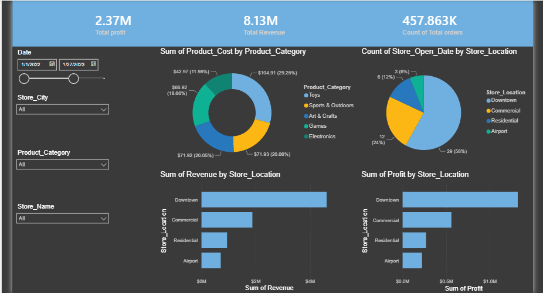
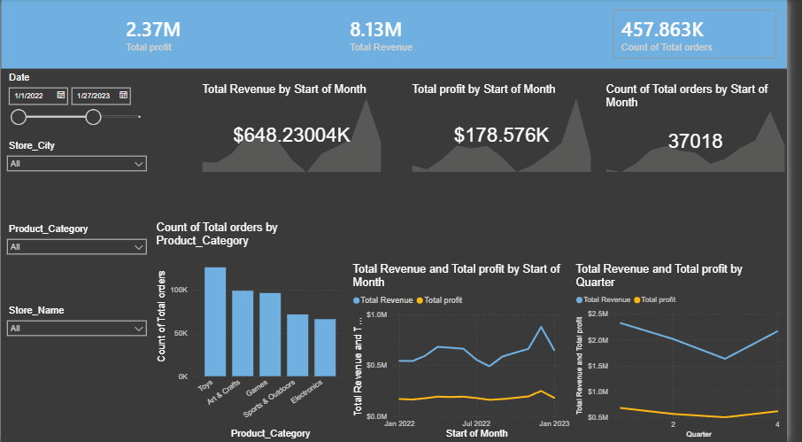
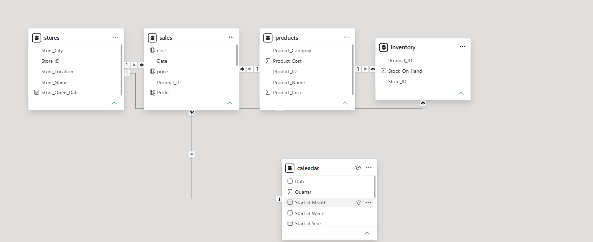
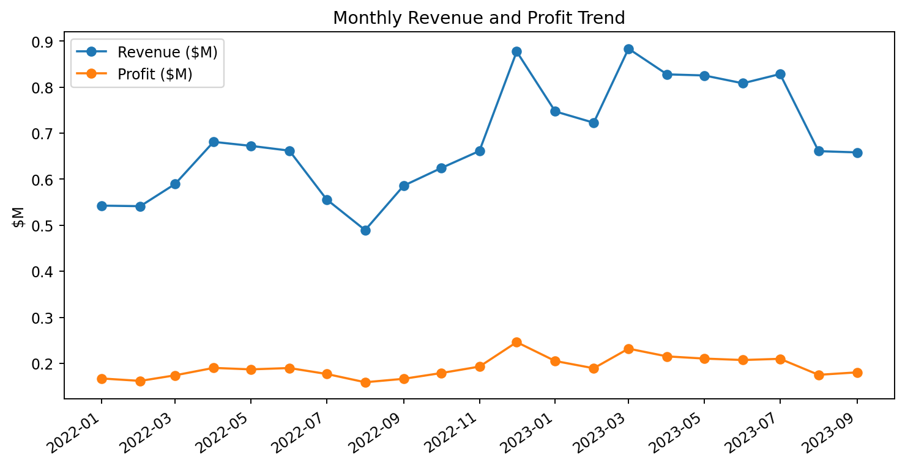
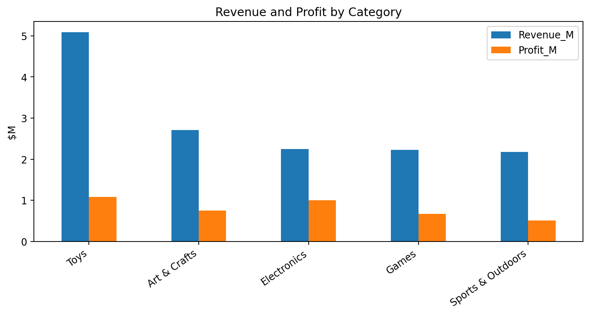
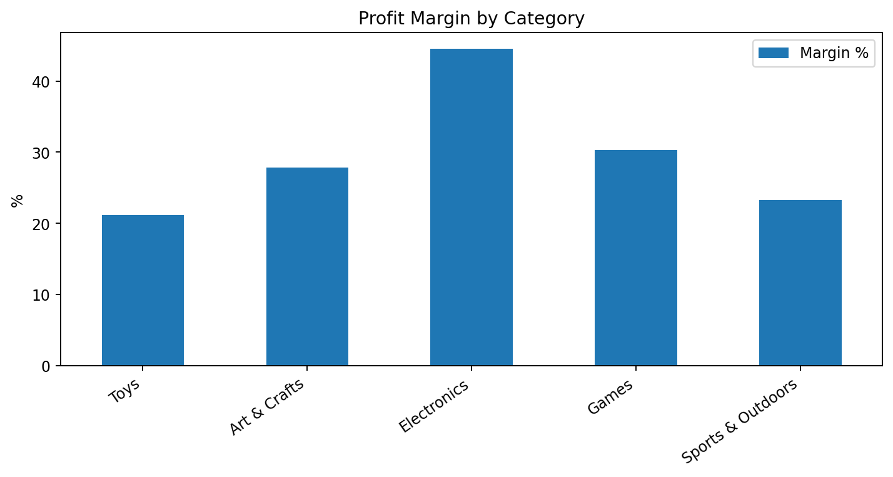
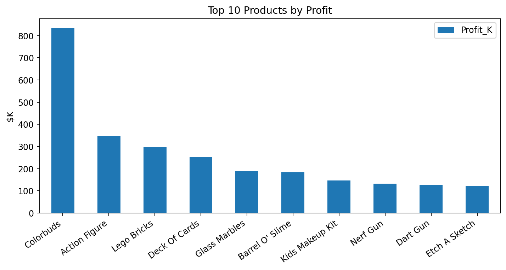
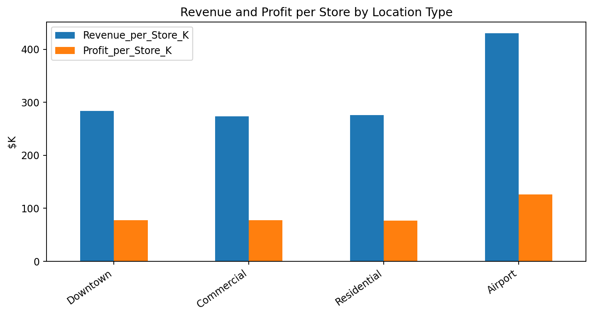

# 🧸 Maven Toys: Executive Sales & Profitability Analysis

A Power BI and Excel project that analyzes **829K transactions** from **Maven Toys**, a fictional toy store chain with 50 stores in Mexico, to find what really drives revenue and profit, and to give management clear, profit-focused recommendations.

## 📌 Overview
| | |
|---|---|
| **Data** | Maven Analytics "Mexico Toy Sales" dataset: 5 tables (sales, products, stores, inventory, calendar) |
| **Period** | January 2022 to September 2023 |
| **Scope** | 829,262 transactions · 1.09M units · 50 stores · 35 products · 5 categories |
| **Tools** | Power BI (Power Query, DAX, data modeling), Excel |
| **Skills** | KPI design, star-schema modeling, profitability analysis, correlation analysis, executive reporting |

## 🔍 What I Did
- **Modeled the data** in Power BI as a star schema: a `sales` fact table linked to `products`, `stores`, `inventory`, and `calendar`.
- **Prepared the tables** in Power Query before loading them into the model.
- **Built DAX measures** for Total Revenue, Total Profit, and Total Orders, plus Revenue and Profit columns calculated from unit price and cost.
- **Designed a 2-page executive dashboard** with KPI cards, trends by month and quarter, category and store-location breakdowns, and slicers for date, city, category, and store.
- **Built an Excel dashboard** with sales, profitability, store and inventory, and marketing views.
- **Analyzed** categories, products, store types, weekdays, and average order value (AOV), and ran a correlation analysis between revenue, profit, units, price, inventory, and store age.
- **Wrote a management report** and an executive summary with prioritized recommendations.

## 📊 Key Results
| KPI | Value |
|---|---|
| Revenue | **$14.44M** |
| Profit | **$4.01M** |
| Profit margin | **27.8%** |
| Transactions | **829K** |
| Average order value | **$17.42** |

- **Margin compression:** comparing Jan to Sep of each year, revenue grew **30.9%** but profit grew only **16.0%**.
- **Toys is the revenue engine, Electronics is the profit engine:** Toys brings $5.09M in revenue at a 21.2% margin, while Electronics earns a **44.6%** margin.
- **Hero product:** **Colorbuds** alone delivers about **20.8% of total profit** (53.4% margin), which is a strength and a concentration risk.
- **Watch Lego Bricks:** high revenue ($2.39M) but only a **12.5%** margin, so its pricing and cost need review.
- **Best store model:** **Airport** stores lead in revenue per store ($430K) and profit per store ($126K).
- **Timing:** Friday and Saturday are the strongest days for revenue.
- **AOV lever:** every **+$1** in AOV adds about **$829K** in revenue at the current transaction volume.

**Recommendations:** move decisions from revenue to profit, invest more in Electronics and Colorbuds, bundle Toys with Electronics to raise AOV, review Lego Bricks pricing, use Airport stores as the benchmark, and give weak stores a 90-day recovery plan.

## 🖼️ Dashboard Preview
**Power BI: executive overview**


**Power BI: revenue, profit, and order trends**


**Data model**


<details>
<summary><strong>More charts from the management report</strong></summary>







</details>

## ▶️ How to View
- **Power BI:** open [`dashboards/maven_toys_dashboard.pbix`](dashboards/maven_toys_dashboard.pbix) in [Power BI Desktop](https://powerbi.microsoft.com/desktop/) (free, Windows). The data is already loaded in the file.
- **Excel dashboard:** open [`dashboards/maven_toys_excel_dashboard.xlsx`](dashboards/maven_toys_excel_dashboard.xlsx).
- **Reports:** read the [management report](reports/Maven_Toys_Management_Report.pdf) and the [executive summary](reports/Maven_Toys_Executive_Summary.pdf).
- **Raw data:** unzip `data/sales.zip`; the other tables are plain CSV files. Field definitions are in `data/data_dictionary.csv`.

## 📁 Project Structure
```
├── dashboards/
│   ├── maven_toys_dashboard.pbix        # Power BI executive dashboard (2 pages)
│   └── maven_toys_excel_dashboard.xlsx  # Excel dashboard (6 sheets)
├── reports/
│   ├── Maven_Toys_Management_Report.pdf # Full 19-page management report
│   └── Maven_Toys_Executive_Summary.pdf # Executive summary and recommendations
├── data/
│   ├── sales.zip                        # 829K transactions (CSV, zipped)
│   ├── products.csv
│   ├── stores.csv
│   ├── inventory.csv
│   ├── calendar.csv
│   └── data_dictionary.csv
└── images/                              # Dashboard and chart screenshots
```

## 📚 Data Source
[Maven Analytics Data Playground: Mexico Toy Sales](https://mavenanalytics.io/data-playground) (fictional data, free to use for learning and portfolios).

## 👤 Author
**Waseem Mahmoud** · [LinkedIn](https://www.linkedin.com/in/waseem-mahmoud-a34154213) · [GitHub](https://github.com/waseemalali)
